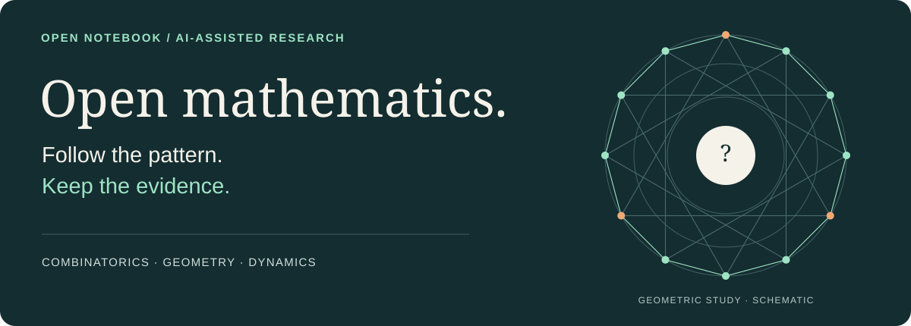
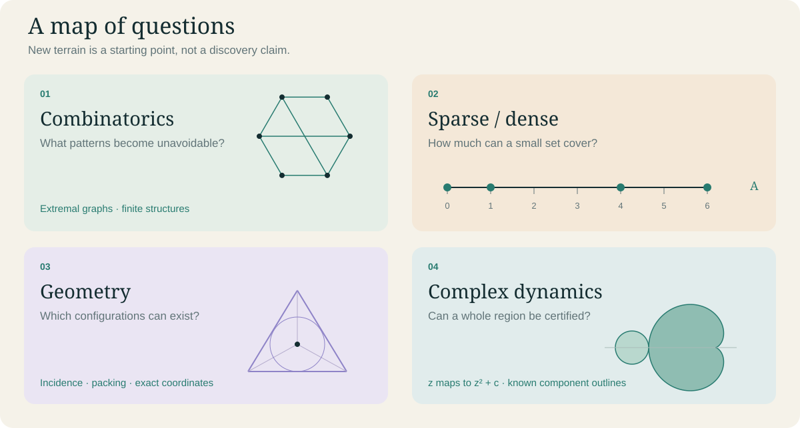
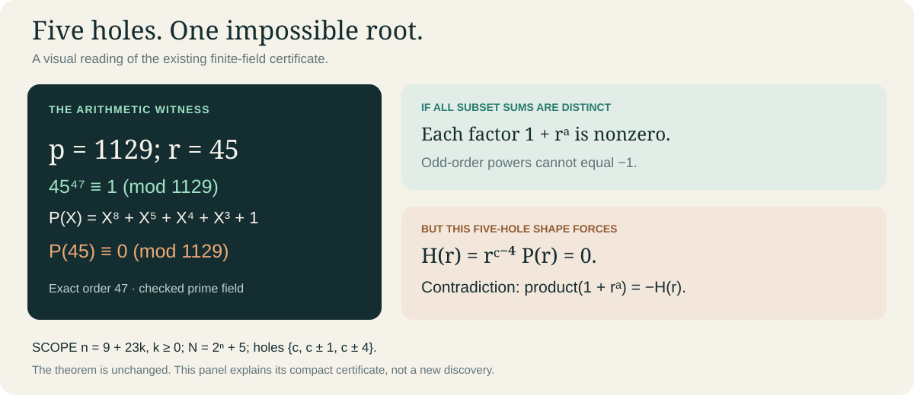
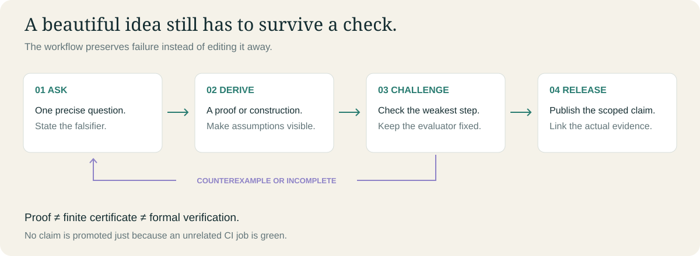

# Open Mathematics Research Lab



**A public, AI-assisted notebook by Arnav.** We follow a precise question from a curious pattern to a proof, a counterexample or an honest limit. The original sparse-ruler experiment suite stays intact below.

[**Explore the questions →**](research-lab/EXPLORE.md) · [**Inspect the evidence →**](research-lab/STATUS.md) · [**Reproduce a certificate →**](research-lab/HARNESS.md) · [Original #170 guide](#sparse-ruler-guide)

> **This is a research notebook, not a list of solved Erdős problems.** An illustration, a finite check and a universal proof have different jobs. Every result keeps its scope and limitations.

## Where curiosity leads



The new directions are **candidate questions**, not newly solved results. [The exploration board](research-lab/EXPLORE.md) gives each a concrete first question, an acceptance test and a prior-art gate. Existing work on #117, #170, #242, #30, #60 and modular subset sums remains eligible.

| Follow a question | What to look for | Evidence route |
|---|---|---|
| Commuting pieces | Group covers, central quotients and structural bounds | [#117](research-lab/problems/erdos-117/README.md) |
| Sparse marks, dense differences | Covering every required distance with few marks | [#170](research-lab/problems/erdos-170/README.md) |
| Distinct subset sums | Modular constructions, missing residues and obstructions | [Main-branch record](research-lab/problems/modular-subset-sums/README.md) · [ongoing PR #5](https://github.com/Arnie016/erdos170/pull/5) |
| Forced four-cycles | What changes just above an extremal edge threshold? | [Restricted polarity work, PR #6](https://github.com/Arnie016/erdos170/pull/6) |
| New mathematical terrain | Geometry, density, sparsity and complex dynamics | [Candidate board](research-lab/EXPLORE.md) |

**Read the branch, not only the headline.** An open PR is not merged evidence. Main's older catalog and its ACTIVE/PARKED labels are historical snapshots, not permanent priorities. Read the latest dated proof and execution receipt before continuing a study.

## What a certificate can look like



For the existing restricted five-hole theorem, the arithmetic witness is just **p = 1129, r = 45**. The new selective verifier checks primality, the exact order, the polynomial identity and the exponent progression. It does not formalize the ordinary proof or establish literature priority.

[Read the short argument](research-lab/harness/PROOF-field47.md) · [Inspect the data](research-lab/harness/certificates/mod5-field47.json) · [Read what is actually checked](research-lab/HARNESS.md)

## How a question becomes evidence



**The loop in words:** recover current evidence, choose one question, state what would falsify it, derive an answer, challenge its weakest step, then preserve the result and its limitations. A negative result can be useful. Reformatting the notebook is not mathematics.

| Evidence label | What it means | What it does not mean |
|---|---|---|
| Analytical proof | A written argument under explicit hypotheses | Independently peer-reviewed or automatically formalized |
| Exact finite certificate | A complete, declared finite claim with a checker | A universal or asymptotic theorem |
| Lean verified at a commit | The stated formal theorem built with audited dependencies | Every nearby prose claim is verified |
| Numerical lead / schematic | A computation or visual suggesting a question | A proof, a certified dimension or set-membership result |

## Run only the check you need

```sh
# One registered certificate, plus exact receipts. Standard library only.
python3 research-lab/harness/verify.py --only mod5-field47

# Fixed negative controls and harness regression tests.
python3 -m unittest discover -s research-lab/harness -p 'test_*.py' -v

# Existing navigation and full historical reproduction remain available.
python3 research-lab/tools/catalog.py --check
python3 research-lab/tools/verify_all.py

# Pinned Lean project: only its declared formal layer.
cd research-lab/lean && lake build
```

The **focused-certificates** CI job covers the new field-witness check. Existing computational and Lean jobs retain their original scope. A green badge elsewhere is not a receipt for this certificate. [Workflow runs](https://github.com/Arnie016/erdos170/actions/workflows/math-research-ci.yml)

## A notebook that gets better at checking itself

Harness changes are reviewed engineering: smaller reproducible checks, preserved failures and clear source-to-claim links. They do not grant the researcher new permissions or allow it to weaken its own evaluator. [Harness contract](research-lab/HARNESS.md) · [Visual design system](research-lab/DESIGN.md) · [Maintenance note](research-lab/maintenance/2026-11-03-visual-harness.md)

[Progress log](research-lab/PROGRESS.md) · [Claim status](research-lab/STATUS.md) · [Lean](research-lab/lean/README.md) · [Reproduce](research-lab/REPRODUCING.md) · [Contribute](research-lab/CONTRIBUTING.md)

Original additions under `research-lab/` use the [scoped MIT license](research-lab/LICENSE). Pre-existing root files and third-party work are not automatically relicensed. AI assistance is disclosed; automated checks are not independent human peer review. Research correspondence stays private.

## Sparse-ruler guide

<details>
<summary>Original #170 installation, experiment commands and paper workflow</summary>

# Sparse Ruler Rigidity Experiment Suite

This project runs simulated annealing experiments for Erdős Problem #170 (sparse rulers / restricted difference bases). It builds candidate mark sets `A ⊆ {0..N}`, tracks distance multiplicities `W(d)`, and searches for complete rulers with near-optimal energy.

## Quick start

```bash
python -m venv .venv
source .venv/bin/activate
pip install -e .
```

### Run a single experiment

```bash
sparse-ruler run 29 9 --runs 50 --steps 200000 --processes 4 --out-dir outputs
```

Outputs:
- `outputs/results_N29_m9.csv` with one CSV row of metrics.
- `outputs/solutions/solution_N29_m9_*.json` with the best 5 solutions.

### Run the default scan

Small scan (N=1..120 with m0, m0+1, m0+2):

```bash
sparse-ruler small-scan --runs 200 --steps 200000 --processes 8 --out-dir outputs
```

Large scan (N in {1000,2000,5000,10000,20000,50000}):

```bash
sparse-ruler large-scan --runs 200 --steps 200000 --processes 8 --out-dir outputs
```

### Compute metrics for a specific ruler

```bash
sparse-ruler metrics 13 0,1,6,9,11,13
```

## Modal execution

If you are running on Modal, the CLI works the same way. Mount the repo, then run:

```bash
python -m sparse_ruler.cli small-scan --runs 200 --steps 200000 --processes 8 --out-dir /mnt/outputs
```

## Notes

- The code keeps `W(d)` updated incrementally when marks move.
- The annealer uses `H = alpha*M + beta*E + gamma*peak` with `alpha=1_000_000`, `beta=1`, `gamma=1000`.
- If `C(m,2) < N`, the run is declared impossible and a CSV row is still written.

## Tests

```bash
pytest
```

## Paper Automation (GitHub + Overleaf)

Generate the latest paper bundle locally:

```bash
cd /path/to/erdos170
export PYTHONPATH=src
python3 scripts/generate_research_report_to_date.py
python3 scripts/build_paper_artifacts.py --repo-root .
```

This writes:

- `paper/main.tex`
- `paper/generated/tables.tex`
- `paper/generated/status_snapshot.json`
- copies of generated markdown/json reports into `paper/generated/`

CI workflow: `.github/workflows/paper-automation.yml`

- Auto-runs on `main` pushes, nightly, and manual dispatch.
- Rebuilds paper artifacts and uploads `erdos170-paper-bundle` artifact.
- Optional Overleaf sync if repository secrets are set:
  - `OVERLEAF_GIT_URL` (required for sync; use Overleaf project Git URL, no token in URL)
  - `OVERLEAF_GIT_TOKEN` (required for sync; generated in Overleaf account Git settings)
  - `OVERLEAF_GIT_BRANCH` (optional, default `master`)

## Cycle-3 Tail-Focused Run

```bash
cd /path/to/erdos170
source .venv/bin/activate
export PYTHONPATH=src
python3 scripts/run_e_hunt_breakthrough_cycle3.py \
  --config configs/e_hunt_breakthrough_cycle3_tailfocus.json
```

Outputs land under:

- `results/e_hunt_breakthrough_cycle3_tailfocus/`

## SAT Feasibility Lane (N=500, m=39)

Build DIMACS + attempt direct solve (requires `python-sat`):

```bash
cd /path/to/erdos170
source .venv/bin/activate
pip install "python-sat[pblib,aiger]"
export PYTHONPATH=src
python3 scripts/run_sat_sparse_ruler_feasibility.py \
  --N 500 --m 39 \
  --mode solve \
  --dimacs-out results/sat_feasibility/sparse_ruler_N500_m39.cnf \
  --json-out results/sat_feasibility/sparse_ruler_N500_m39_result.json
```

DIMACS-only mode (external solver):

```bash
python3 scripts/run_sat_sparse_ruler_feasibility.py \
  --N 500 --m 39 --mode dimacs
```

</details>
