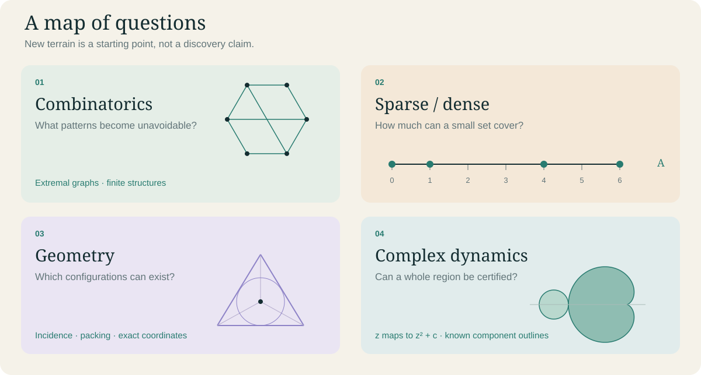

# Exploration board

**Scope expanded by the project owner on 3 November 2026.** This board broadens the older six-lane selection policy. It adds candidate directions, not results, permanent priorities or permission to weaken evidence standards. All established safety and publication limits survive. One question per research run; at most two serious candidates considered.

## Combinatorics: when structure becomes unavoidable

**Candidate:** for a specified family of sparse graphs, which local edge changes necessarily create a forbidden configuration? Declare the vertex class and actual extremal baseline before a search. Compare the known #60 polarity-edit work before proposing a new switch inequality.

**Acceptance:** an ordinary inequality with explicit hypotheses, or a complete counterexample with independently reconstructed cycle counts. Neither a small graph nor a restricted edit family proves an all-n theorem.

## Sparse support, density and correlation

**Candidate:** fix a finite cyclic group and a support size. Decide whether a proposed bound relating additive energy to concentration of the difference multiplicities is sharp in a declared family. Define ordered versus unordered pairs and normalizations before derivation. The elementary Cauchy-Schwarz energy inequality is background, not the target discovery.

**Alternative interpretation of active sparsity:** active-set identification in mathematical sparse optimization. First compare existing finite-identification bounds before selecting a nondegeneracy gap or an exact counterexample. Do not silently treat this phrase as a single established theory.

**Acceptance:** a genuinely stronger scoped inequality, a sharpness construction or an exact counterexample. Finite density estimates do not imply an unrestricted asymptotic statement.

## Geometry: see the obstruction

**Candidate:** choose one rational point configuration or packing family. Is a proposed incidence or separation bound forced by its geometry? Fix dimension, metric, tangencies and degeneracies. Search first for the closest known incidence/packing result.

**Acceptance:** exact coordinates with a complete geometric predicate checker, or a proof valid for every member of the stated family. An attractive drawing is only a schematic unless its coordinates are checked.

## Complex dynamics: more than a beautiful picture

**Candidate:** a rigorously certified parameter box for f_c(z)=z^2+c near a selected periodic component. Compare established component geometry, then identify one unresolved certificate or proof simplification with a stated mathematical payoff. A standard cardioid or period-two derivation is an explanatory baseline.

**Acceptance:** outward-rounded interval bounds or an exact argument valid throughout the declared box; otherwise NUMERICAL_LEAD or BLOCKED. Finite nonescape does not prove membership. Parameter-plane statements about c and dynamical-plane statements about z must remain distinct. No claim about the full Mandelbrot boundary or its dimension follows from an image.

## Primary starting points and reading depth

These are orientation sources, not a new comprehensive status review or a claim that any candidate above is open. Checked 3 November 2026.

- Tao and Vu, *Additive Combinatorics*: [author's book page](https://www.math.ucla.edu/~tao/preprints/books.html). Depth: bibliographic/toolbox description only; that page identifies itself as obsolete, so follow current sources before a frontier claim.
- Hare, Schmidt and Nutini, *Active-set complexity of proximal gradient: How long does it take to find the sparsity pattern?*: [author-posted record](https://optimization-online.org/2017/12/6369/). Depth: abstract and publication metadata; no full proof audit. Existing active-set bounds must be compared before proposing novelty.
- Dierk Schleicher, *Rational parameter rays of the Mandelbrot set*, [arXiv:math/9711213](https://arxiv.org/abs/math/9711213). Depth: introduction and Theorem 1.1 inspected; proofs not audited. It is a bridge between combinatorics and dynamics, not evidence that a new ray-landing theorem is needed.

Retain the original [portfolio](PORTFOLIO.md) and [claim status](STATUS.md). New studies receive their own precise contract only when selected. Before accepting a new theorem, check primary successors and exact hypotheses rather than inferring novelty from an empty search.
