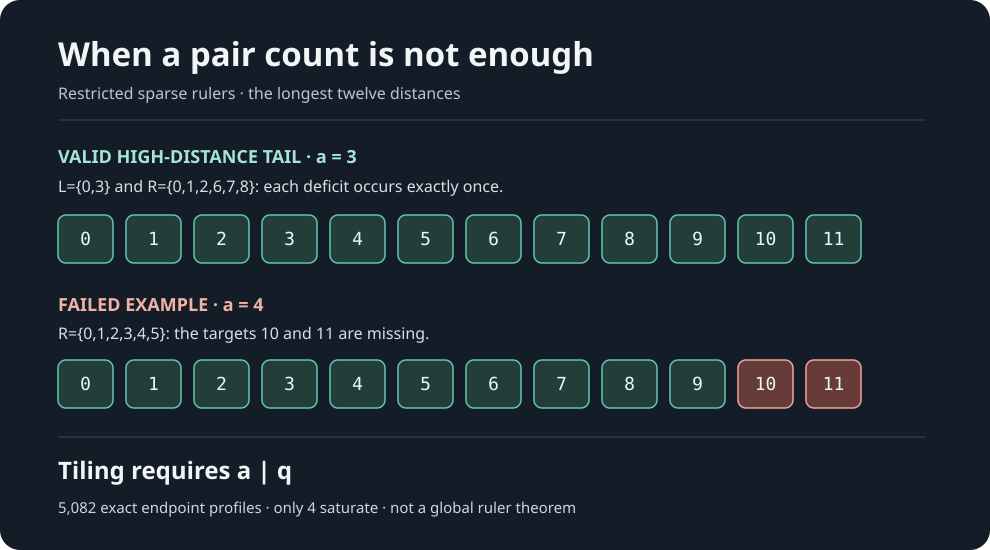

# Endpoint-tail rigidity for restricted sparse rulers

**Claim ID:** R170-TAIL-TILING-2026-11-10  
**Validity:** ANALYTICAL_PROOF (with finite supplemental certificate)  
**Literature:** known polynomial-tiling method; specific-priority unchecked  
**Formalization:** UNFORMALIZED

Let (qge1), (Nge4q-1). Let (Asubset{0,ldots,N}) be a **complete restricted ruler**, meaning every integer distance (1,ldots,N) is a difference of two marks. Put (t=2q), and define
[
 L=Acap{0,ldots,t-1},qquad
 R={N-b:bin A, N-t+1le ble N}.
]
Suppose (L={0,a}) for (1le a<t) and (|R|=q).

**Theorem.** Necessarily (amid q), and the entire reflected right tail is uniquely forced:
[
 R=igcup_{j=0}^{q/a-1}{2aj,2aj+1,ldots,2aj+a-1}.
]

**Proof.** For (0le s<t), representing the distance (N-s) means choosing marks (u,b) with (b-u=N-s), equivalently (u+(N-b)=s). Thus every target (sin{0,ldots,t-1}) belongs to (L+R). Exactly (|L||R|=2q=t) ordered pairs exist, so there can be no repeated sums or sums outside the target range. With (R(X)=sum_{rin R}X^r) this forces
[
(1+X^a)R(X)=1+X+cdots+X^{2q-1}
              =rac{1-X^{2q}}{1-X}.
]
Take a primitive (2a)-th root of unity (zeta). Since (1+zeta^a=0), the right side vanishes. As (zeta
e1), we obtain (zeta^{2q}=1); because (zeta) has order (2a), this means (amid q).

When (amid q), polynomial division uniquely yields
[
R(X)= (1+X+cdots+X^{a-1})
      (1+X^{2a}+cdots+X^{2a(q/a-1)}).
]
Its nonzero coefficients occur exactly at the indicated (q) places. Conversely these tails cover the **top (2q) distances** exactly once, but this does **not** guarantee a complete ruler covering the other distances. QED.

**Density-cut corollary.** If a complete restricted ruler has precisely ({0,a}) within its first (2q) positions and (a
mid q), then it must have **at least (q+1)** marks in its final (2q) positions. The naive count (|L||R|ge2q) is not sufficient at equality.

## Exact finite confirmation: (q=6)

Fix (t=12,N=23). Enumerate every (a=1,ldots,11), and every (6)-subset (Rsubset{0,ldots,11}) containing zero. The domain contains exactly (11inom{11}{5}=5,082) profiles. Two independently structured programs check the complete domain.

Only four profiles cover the twelve distances (12,ldots,23):

| (a) | Unique (R) |
|---|---|
| 1 | 0,2,4,6,8,10 |
| 2 | 0,1,4,5,8,9 |
| 3 | 0,1,2,6,7,8 |
| 6 | 0,1,2,3,4,5 |

For (a=4), **no** six-mark right tail can achieve the twelve long distances, even though the pair count (2cdot6=12) appears sufficient.

*The diagram illustrates a feasible and one infeasible tail profile. The general impossibility for (a=4) is the theorem, not the picture.*

**Boundary:** These are only local long-distance constraints. No exact (F(23)), new lower bound for (F(N)), solution to Erdős #170, proof of ruler optimality or mathematical novelty is claimed.