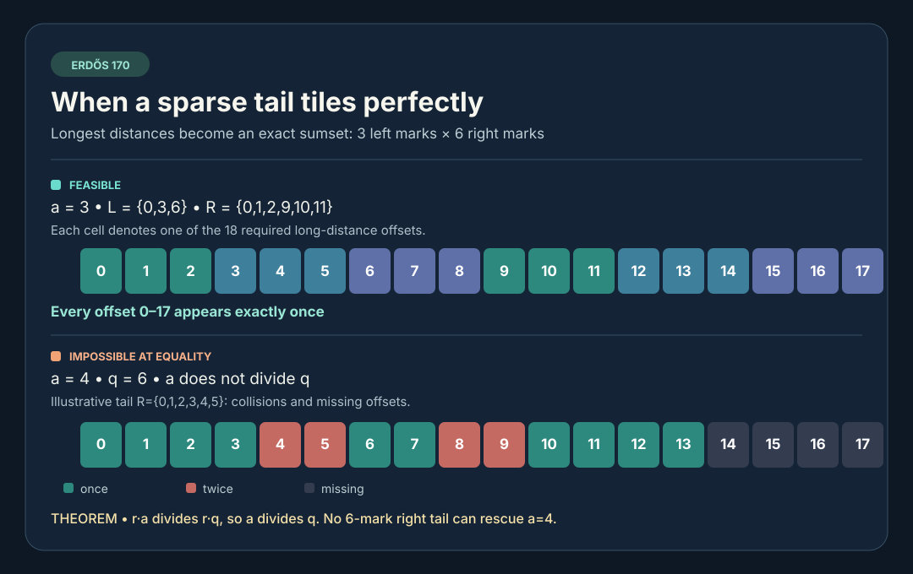

# Multi-mark endpoint rigidity | Erdős #170

A verified generalization of the earlier two-left-mark endpoint-tail theorem to \(r\) equally spaced left marks. It is a **conditional necessary structural result**, not a solution of the unrestricted sparse-ruler problem.

The exact mathematical argument is in [PROOF.md](PROOF.md). The [research contract](RESEARCH_CONTRACT.md), [source ledger](SOURCES.md), [claims](CLAIMS.json) and [run report](RUN_REPORT.md) distinguish general proof, finite experiment, literature status and remaining gaps.

Both independently structured exact checkers enumerate all 49,504 specified profiles for \(r=3,q=6,N=35\); neither asserts that the endpoint profiles are complete sparse rulers. The exact 39-mark length-500 near-ruler candidate is **not available** in this recovery, so it was not retested.
