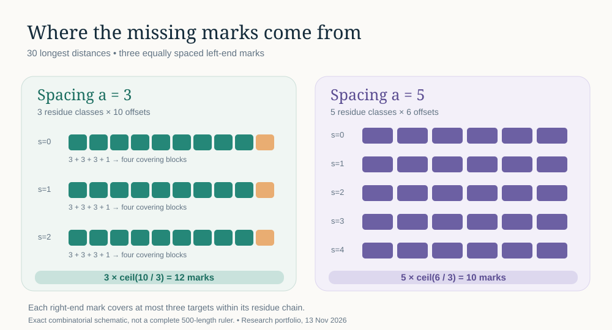

# Residue-chain endpoint density | Erdős #170

This is the 13 November **verified continuation** of a proof derived on 12 November. The 12 November second checker stopped at an incorrect negative-control assertion; today the exact corrected checker passed alongside the original constructive checker. This is acceptance of a *local conditional theorem*, not a second discovery or a solution of Erdős #170.

For a ruler whose leftmost \(t\) positions contain exactly \(\{0,a,\ldots,(r-1)a\}\), the number of rightmost-window marks required to measure the longest \(t\) distances is at least \(\sum_{s=0}^{a-1}\lceil m_s/r\rceil\), where \(m_s\) is the number of target offsets congruent to \(s\pmod a\). This bound is sharp *for those distances alone*. See [proof](PROOF.md), [claim contract](RESEARCH_CONTRACT.md), [execution records](RUN_REPORT.md), [sources](SOURCES.md) and [machine-readable claims](CLAIMS.json).

Two exact implementations now agree on the fourteen prescribed profiles \(r=3,t=30,a=1,\ldots,14\); the second also enumerates all \(2^{12}\) possible right tails for each of five smaller profiles. No general ruler optimality is claimed.
