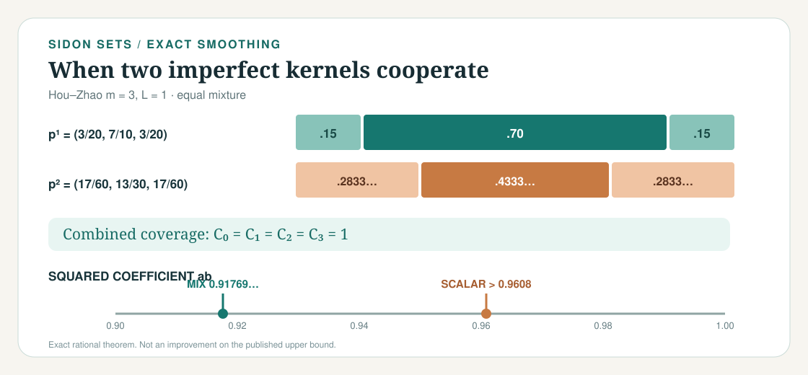

# When two three-bin kernels cooperate

*Original exact-parameter illustration. Bin widths encode probabilities; the axis compares squared asymptotic coefficients. The numerical markers are rounded; the theorem uses rational bounds.*

**Scoped result, 20 November 2026:** For the Hou–Zhao smoothing setting m=3, L=1, every individually feasible symmetric three-bin kernel p=(t,1−2t,t), t in [0,1/2], with arbitrary real boundary weights satisfies **ab > 1201/1250**. An explicit equally weighted pair of kernels has **ab = 1150153/1253320**, strictly smaller. The underlying vector-valued mechanism is known; the priority of this specialization has not been audited.

Read [the mathematical proof](PROOF.md), [source scope](SOURCES.md), [claim contract](CONTRACT.md), [execution receipts](RUN_REPORT.md), [exact grid checker](worker2_grid_independent.py) or [checkpoint](CHECKPOINT.md). Only the frozen 190-pair finite grid is algorithmically exhaustive; the continuous scalar result has an ordinary symbolic proof.

**Not a new Sidon record.** Hou–Zhao already report coefficient 0.94349…, better than this construction's approximately 0.958. No full Erdős #30 solution, independent human review or Lean verification is claimed.
