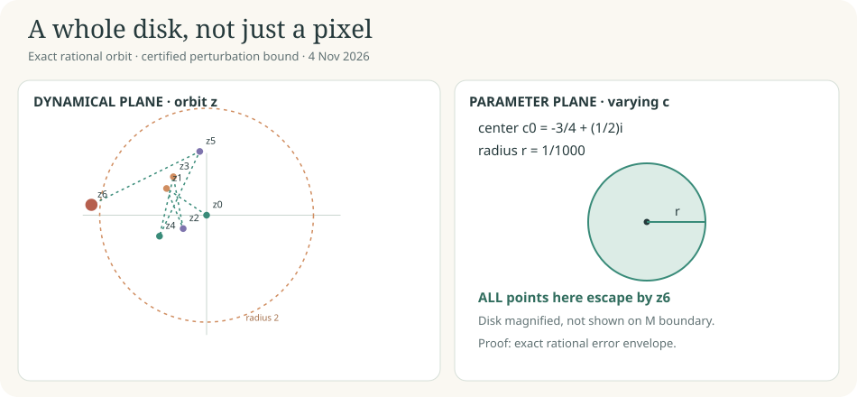

# A whole disk, not just a pixel

**4 November 2026.** A rigorous exclusion of one rational disk from the Mandelbrot parameter plane, with an editable visual and exact-arithmetic proof.

**Question.** For \(z_0=0,\ z_{j+1}=z_j^2+c\), is every \(c\) with \(|c-(-3/4+i/2)|\le1/1000\) excluded from the Mandelbrot set?

**Answer.** Yes. Exact rational bounds prove that all these parameters satisfy \(|z_6(c)|>2\). Left panel: the orbit at the center \(c_0\). Right panel: a disk of varying parameters, **not** a drawing of the full fractal boundary. The parameter circle is magnified.

[Ordinary proof](PROOF.md) · [Exact certificate](CERTIFICATE.json) · [Executed primary checker](worker1.py) · [Run receipts](RUN_REPORT.md) · [Next discriminating test](CHECKPOINT.md)

**Status.** ANALYTICAL_PROOF + EXACT_FINITE_CERTIFICATE for this one disk, not new general mathematics. The classical escape-radius criterion is known. Formalization UNFORMALIZED. First worker exit 0; second worker had a *post-check reporting failure* (exit 1), with no retry. Dedicated GitHub CI and independent clean reproduction are pending.
