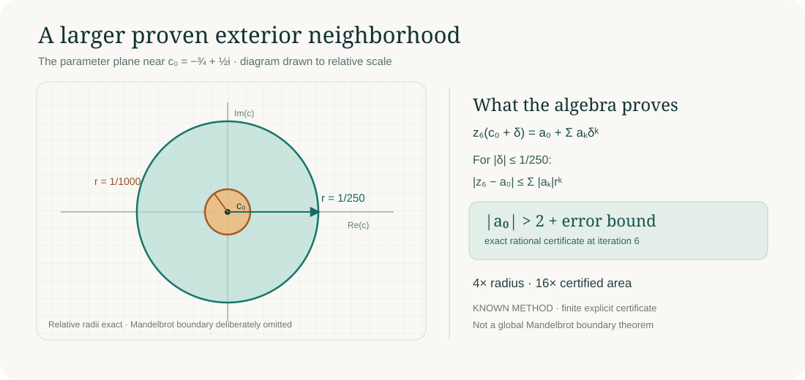

# The escaped neighborhood grows

**MAND-EXTERIOR-2026-11-05-A.** For the quadratic map z → z²+c, the closed parameter disk centered at c0=-3/4+i/2 with radius **1/250** is certified exterior to the Mandelbrot set by the sixth iterate. The previous radius-1/1000 disk is contained in it. The new radius is 4 times larger and the area 16 times larger.

The picture draws the relative sizes of these certified disks to scale. It deliberately **does not depict the Mandelbrot boundary**. View the [ordinary proof](PROOF.md), [worker receipts](RUN_REPORT.md), [sources](SOURCES.md) and [next-test checkpoint](CHECKPOINT.md).

The two standalone Python 3 checkers use only its standard library. Run worker1.py or worker2.py. Both return exact rational coefficient data and flags for the declared domain. Local receipts validate these source versions; no dedicated new-study GitHub CI or Lean verification is claimed.

