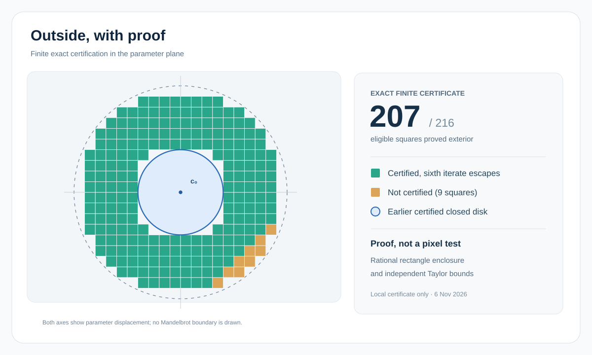

# 207 squares outside the Mandelbrot set, with proof

For the quadratic iteration zₙ₊₁=zₙ²+c, centered at c₀=−3/4+i/2, two different rational procedures agree that **207 of 216** eligible 0.001×0.001 parameter squares in an annulus escape by the sixth step. The nine remaining eligible squares are **not certified**, which does not imply membership in the Mandelbrot set.

[Ordinary proof](PROOF.md) · [Exact cell indices](CERTIFIED_CELLS.json) · [Checkpoints](CHECKPOINT.md) · [Sources](SOURCES.md) · [Local execution receipts](RUN_REPORT.md)

To regenerate the proof-bearing cell lists in a trusted Python 3 environment from this directory, run the scripts **sequentially**:

    timeout -k 1s 35s python3 worker1.py > worker1.json
    timeout -k 1s 35s python3 worker2.py > worker2.json

No third-party Python packages are needed. Both processes reproduce the same 207-index list. The figure depicts certificate scope, not the actual fractal boundary. This is **not** a solution to a global mathematical problem.
