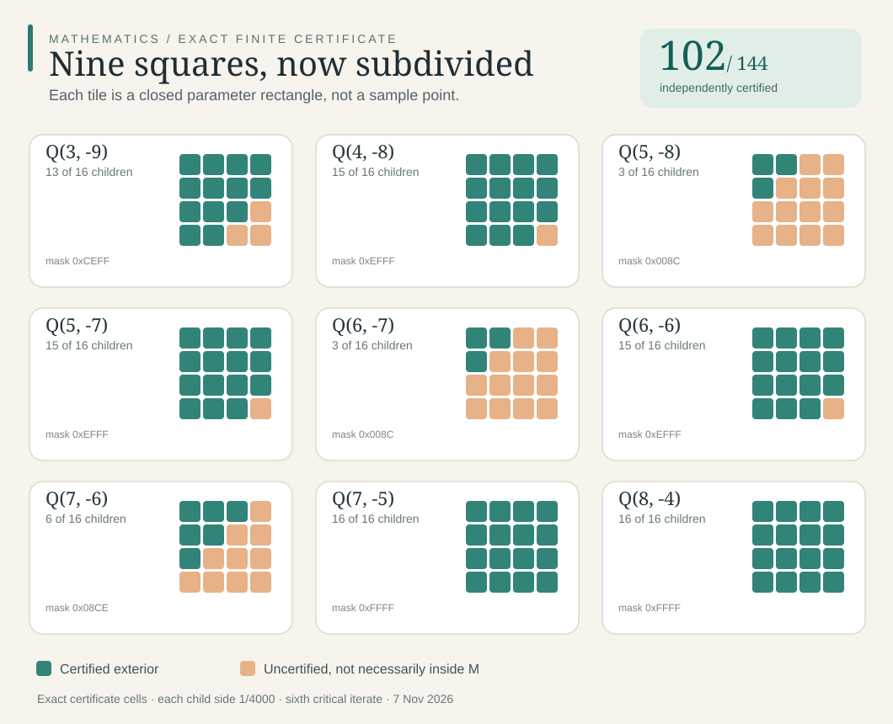

# Refined Mandelbrot exterior certificates | 7 November 2026

**102 of 144** child squares are certified exterior. **Two parent squares are entirely certified.** The remaining 42 are *uncertified*, not shown to be inside the Mandelbrot set. The vector graphic is generated from the exact bitmasks, not sampled pixels.

[Proof](PROOF.md) · [Certificate](CERTIFIED_SUBCELLS.json) · [Run receipts](RUN_REPORT.md) · [Source ledger](SOURCES.md) · [Next test](CHECKPOINT.md).

To reproduce: run python3 worker1.py >worker1.json, followed by python3 worker2.py >worker2.json, each under a hard 35-second timeout. Local executions succeeded but dedicated GitHub CI has not been observed.
