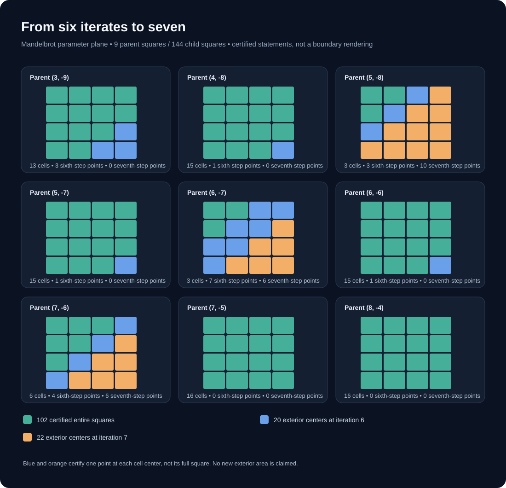

# Seven iterates settle the delayed centers

On 8 November, 22 of 42 unresolved child-square **centers** had not escaped by the sixth iterate. Today's exact seventh-iterate test proves **all 22 centers escape at the seventh iterate**. The other 20 centers already escaped by iteration six. Thus all 42 *centers* are outside the Mandelbrot set, but **zero additional whole cells or area are certified**.

Read [PROOF.md](PROOF.md) for the precise claim, [CLAIMS.json](CLAIMS.json) for scope and [RUN_REPORT.json](RUN_REPORT.json) for local worker receipts. Reproduce with `python3 run_workers.py`, which runs `worker1.py` and `worker2.py` sequentially with 35-second kill limits. Only current local runs are documented, not dedicated GitHub CI or Lean verification. Mathematical method known, exact case priority unchecked.
